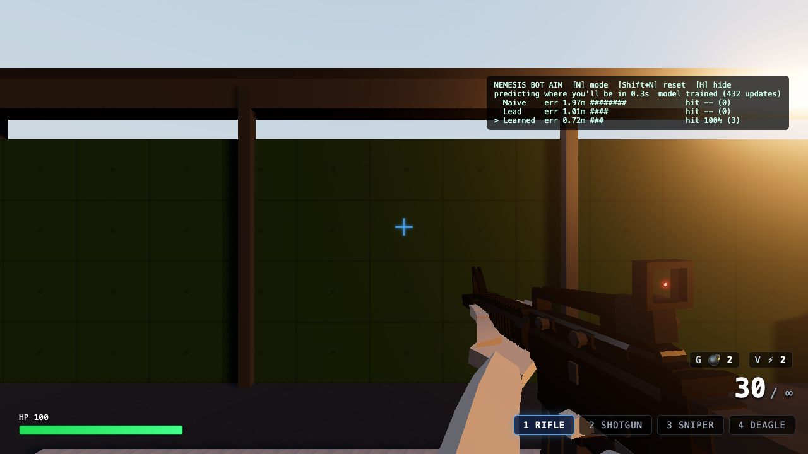
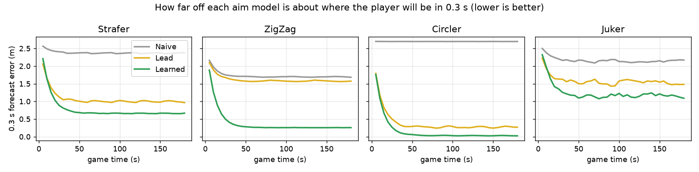

# Nemesis Engine

Capstone project, Full Sail University Computer Science master's program.

Nemesis Engine adds an AI opponent that learns how you play to **LAB ARENA**, my browser-based
multiplayer 3D shooter (three.js client, Node.js server). The goal is a bot that does not just aim
at you faster: it learns where you are going to be.



## Milestone 1 (v0.1.0)

The original LAB ARENA bots rolled a dice for every shot. In this build, bots that shoot at a human
**aim instead**. When a bot decides to fire, it predicts where you will be after a 0.3 s reaction
delay (about human reaction time) and the shot lands on that point. If you are not there, it misses.
The only way the bot gets better is by predicting your movement better.

There are three aim modes. The host switches between them in a match with **N**:

| Mode | How it aims |
|---|---|
| Naive | Where you were when it decided to shoot: a plain aimbot with a reaction delay. |
| Lead | Assumes you keep moving in a straight line at your current velocity. |
| Learned | An online model that learns your movement habits while you play. |

The learned model is a small linear model per player, trained online with recursive least squares.
It looks at your recent velocity relative to the bot (toward/away, left/right) and how long you have
been strafing in one direction. Every tick it checks where you actually went and updates itself.
The Nemesis panel in the top right scores all three modes against your real movement, so you can
watch the learned model's error drop. Later milestones replace this model with a player-style model
and reinforcement learning counter-policies trained with my own PPO implementation.

### Results

`npm run eval` makes four scripted test players fight a bot in each mode for 3 minutes, using the
same reaction delay, aim spread, and hit radius as the server. Bot hit rate:

| Test player | Naive | Lead | Learned |
|---|---|---|---|
| Strafer (reverses every 1.2 s) | 29.8% | 47.7% | **71.1%** |
| ZigZag (diagonal switches every 0.5 s) | 8.7% | 40.3% | **75.6%** |
| Circler (circles the bot) | 0.0% | 76.5% | **96.6%** |
| Juker (random reversals) | 5.8% | **42.1%** | 25.5% |

The learned bot is best against players with habits. Against random jukes, it is closer on average
than lead aim (chart below) but lands fewer exact hits, because it hedges between directions. Two
problems to fix next: the Juker case, and the Circler case, where 96.6% is too punishing and is the
reason the fairness governor in the design exists.



## Run it

Requires Node.js 18 or later.

```bash
npm install
npm start            # http://localhost:8090/cod/  (this computer only)
npm test             # unit tests + an end-to-end server test
npm run eval         # headless bot evaluation, writes eval_out/
```

In the game: PLAY, DEPLOY, then **+ ADD AI** in the lobby and START GAME.

| Key | Action |
|---|---|
| WASD, mouse, click | Move, aim, shoot |
| N | Cycle bot aim mode (host only): naive, lead, learned |
| Shift+N | Reset the learned models (host only) |
| H | Hide or show the Nemesis panel |

All original LAB ARENA controls still work (see the in-game menu).

## Project layout

| Path | Contents |
|---|---|
| `ai/nemesis-aim.js` | The aim models: naive, lead, learned (online RLS), and the scoreboard. |
| `ai/nemesis-bot.js` | Connects the models to the server's bot loop: reaction delay, aim spread, hit test, HUD stream. |
| `server.js` | LAB ARENA game server. Nemesis hooks are marked `NEMESIS`. |
| `public/cod/` | LAB ARENA browser client (three.js). Adds the Nemesis panel and keys. |
| `tools/eval.js` | Headless evaluator with scripted test players. |
| `tools/screenshot.js` | Dev helper that plays a short match in headless Chromium and saves a screenshot. |
| `tests/` | `node:test` unit tests and an end-to-end server test. |

`heromode-server.js`, `nfs-server.js`, and `fight-server.js` are LAB ARENA modules the server loads
for its other game modes; they are unchanged.

## Rules this project follows

LAB ARENA uses libraries only (three.js for rendering, ws for networking), no game engine. All AI
is my own code. No AutoML or hosted AI service is used, and the bots never read input the player
could not also see: they only use positions the server already has, and they need line of sight.
Asset credits are in `public/cod/CREDITS.md` and `THIRD_PARTY_ASSETS.md`.
