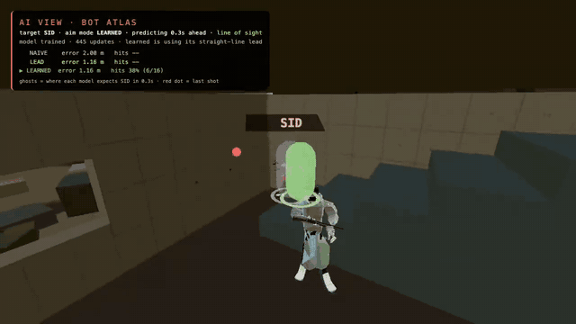
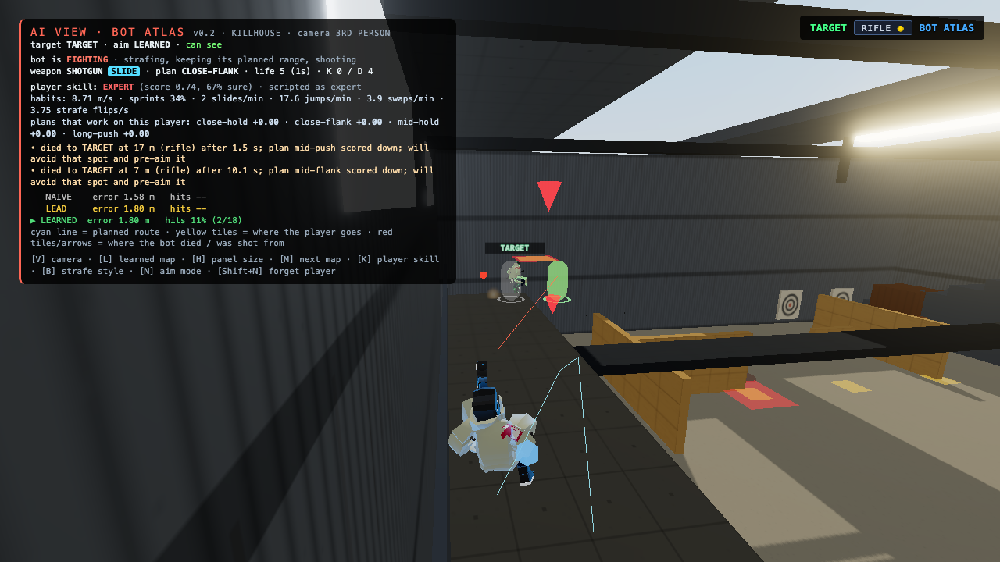
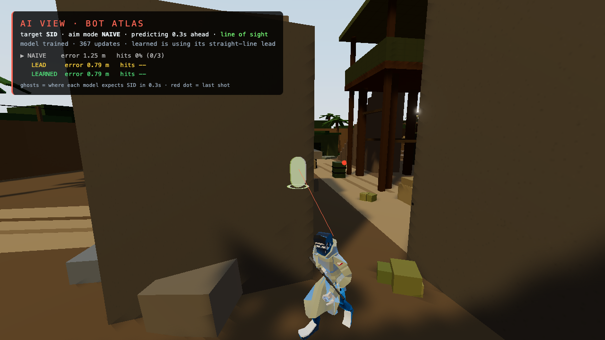
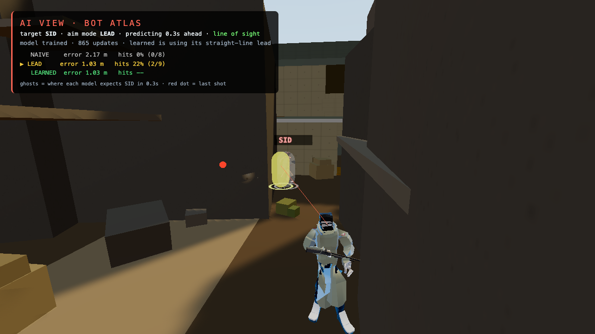
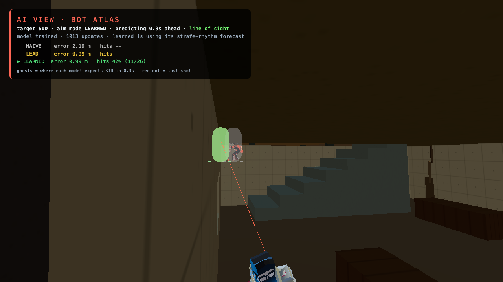
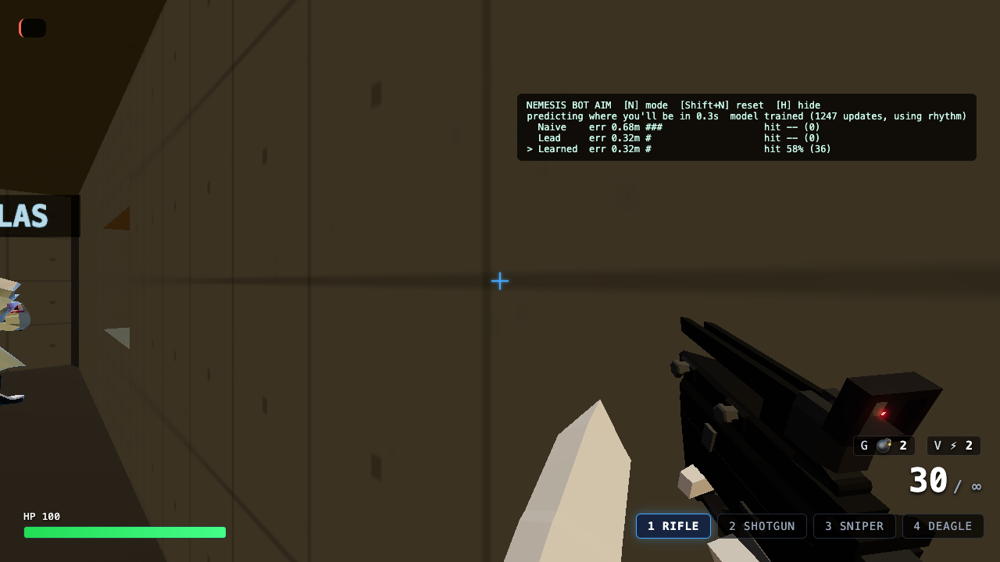

# Nemesis Engine

Capstone project, Full Sail University Computer Science master's program.

Nemesis Engine adds an AI opponent that learns how you play to **LAB ARENA**, my browser-based
multiplayer 3D shooter (three.js client, Node.js server). The goal is a bot that does not just aim
at you faster: it learns where you are going to be.



*AI view, recorded in-game: an over-the-shoulder camera on the bot. The ghosts show where each aim
model expects the player to be 0.3 s from now (gray naive, yellow lead, green learned), the red line
is where the bot is aiming, and the red dot is its last shot. Full 2-minute clip:
[docs/media/aiview_gameplay.mp4](docs/media/aiview_gameplay.mp4).*

## Milestone 2 (v0.2.0)

Bots now find their way around every map, sprint, slide, jump and swap weapons, and **learn the
player during the match**: habits every second, fight plans every 1.5 s and on every kill or
death, and the player's skill level (beginner / average / expert) every 5 s, which changes how hard
they play. Full measurements against v0.1: **[docs/MILESTONE2.md](docs/MILESTONE2.md)**.

Measured over 162 simulated matches (6 maps × 3 player skills × 3 bot versions × 3 seeds,
10 min each):

| | v0.1 | v0.2 |
|---|---|---|
| Time stuck while moving | 21.9% | 0.2% |
| Shots fired while facing away | 186 | 0 |
| Map reached | 27% | 52% |
| K/D vs. expert players | 0.26 | 0.45 |
| Player skill rated correctly after 60 s | n/a | 45/54 |



Demo video: [docs/media/nemesis_m2_demo.mp4](docs/media/nemesis_m2_demo.mp4).

## Milestone 1 (v0.1.0)

The original LAB ARENA bots rolled a dice for every shot. In this build, bots that shoot at a human
**aim instead**. When a bot decides to fire, it predicts where you will be after a 0.3 s reaction
delay (about human reaction time) and the shot lands on that point. If you are not there, it misses.
The only way the bot gets better is by predicting your movement better.

There are three aim modes. The host switches between them in a match with **N**:

| Mode | How it aims |
|---|---|
| Naive | Where you were when it decided to shoot: a plain aimbot with a reaction delay. |
| Lead | Assumes you keep moving in a straight line at your current velocity. |
| Learned | An online model that learns your movement habits while you play. |

Learned mode learns two things about each player while they play:

1. **How they move.** A small linear model trained online with recursive least squares (your recent
   velocity relative to the bot, how long you have held a strafe direction), and a record of your
   strafe rhythm (how long you usually hold a direction before reversing).
2. **Which forecast actually lands on them.** It scores three candidate aim points against where you
   really went (the RLS forecast, the rhythm forecast, and a plain straight-line lead) and fires
   with whichever has the best recent hit rate. Against a player with no pattern it falls back to
   lead, so it is never worse than lead.
The Nemesis panel in the top right scores all three modes against your real movement, so you can
watch the learned model's error drop. Later milestones replace this model with a player-style model
and reinforcement learning counter-policies trained with my own PPO implementation.

### Results

`npm run eval` makes four scripted test players fight a bot in each mode for 3 minutes, using the
same reaction delay, aim spread, and hit radius as the server. Bot hit rate:

| Test player | Naive | Lead | Learned |
|---|---|---|---|
| Strafer (reverses every 1.2 s) | 29.8% | 47.7% | **78.5%** |
| ZigZag (diagonal switches every 0.5 s) | 8.7% | 40.3% | **83.4%** |
| Circler (circles the bot) | 0.0% | 76.5% | **96.4%** |
| Juker (random reversals) | 5.8% | 42.1% | 42.1% |

The learned bot is best against players with habits and ties lead against random jukes (nothing to
learn). The 96.4% against circling is too punishing; that is what the fairness governor in the
design is for.

**In the real game** (the AI-view recording above: a scripted player strafing on a 1.1 s rhythm in
the Firing Range, 0.3 s reaction delay, aim spread, line of sight required), the bot hit 0% in naive
mode (0/8), 22% in lead mode (2/9), and 42% in learned mode (11/26), with learned starting from a
wiped model. The scripted player there is jerkier than in the headless test because the browser
runs slowly in software rendering, so the learned bot spends much of the clip on its lead fallback
before its rhythm forecast takes over. Samples are small; the headless table is the controlled
comparison.


### How the bot moves

Bots run a small state machine (`ai/nemesis-tactics.js`) instead of standing still and shooting:

| State | What the bot does |
|---|---|
| Patrol | Walks between spawn areas when it knows of no enemy. |
| Engage | Strafes on an irregular rhythm, keeps its weapon's preferred range, and fires only after a 0.35 to 0.65 s reaction to a new sighting. |
| Take cover / In cover | After a few seconds of fighting, or when hit, runs to a nearby spot the enemy cannot see and waits. |
| Peek | Steps back out to a spot with a view of where the enemy was, already aimed there. |
| Hunt / Search | When it loses sight, goes to where the learned model **predicts** the enemy went (not where they really are), then searches around it. |

Bots also have a field of view of about 130 degrees: they do not notice enemies behind them unless
they are very close or just shot them. The AI view shows the current state, and a marker for where
the bot is heading (blue for cover and peek spots, orange for the predicted position it is hunting).

### More screenshots

| Naive | Lead | Learned, after training |
|---|---|---|
|  |  |  |

The player's own view, with the Nemesis panel: 

## Run it

Requires Node.js 18 or later.

```bash
npm install
npm start            # http://localhost:8090/cod/  (this computer only)
npm test             # unit tests + an end-to-end server test
npm run eval         # Milestone 1 aim evaluation, writes eval_out/
npm run m2           # Milestone 2: v0.1 vs v0.2 matches + report (needs python3 + matplotlib)
```

In the game: PLAY, DEPLOY, then **+ ADD AI** in the lobby and START GAME.

**AI demo (one tab, no playing needed):** open
`http://localhost:8090/cod/?demo=1&map=killhouse&skill=expert`. It starts a match with one Nemesis
bot and a scripted player that fights back, and puts you in the AI view. `map` is any of shipment,
killhouse, range, blackout, districts, monastery; `skill` is beginner, average or expert.

| Key | Action |
|---|---|
| V | Camera: 3rd person → 1st person (bot's eyes) → world (free camera: WASD, Q/E, Shift, drag to look) |
| M / K | Next map / next player skill (demo) |
| L | Show what the bot learned (heat, danger, threat spots) |
| H | AI panel: full → small → hidden |
| N / Shift+N | Aim model / forget the player |
| B | Player strafe style: steady rhythm or random |

**AI view of your own match:** while a match is running, open a second tab at
`http://localhost:8090/cod/?name=AIVIEW&code=<room code>&spectate=1`. The observer is invisible to
everyone and bots ignore it; it rides over the first bot's shoulder and shows its predictions.

**Re-record the clip:** `NEMESIS_NO_BOT_DAMAGE=1 npm start` in one terminal, then
`node tools/record.js 8090` (headless Chromium via Playwright). No-damage mode only keeps the
scripted player alive for the camera; hits are still counted.

| Key | Action |
|---|---|
| WASD, mouse, click | Move, aim, shoot |
| N | Cycle bot aim mode (host only): naive, lead, learned |
| Shift+N | Reset the learned models (host only) |
| H | Hide or show the Nemesis panel |

All original LAB ARENA controls still work (see the in-game menu).

## Project layout

| Path | Contents |
|---|---|
| `ai/nemesis-aim.js` | The aim models: naive, lead, learned (online RLS), and the scoreboard. |
| `ai/nemesis-bot.js` | Shot pipeline: reaction delay, aim spread, hit test, HUD and AI-view streams. |
| `ai/nemesis-brain.js` | v0.2 bot brain: states, fight plans, abilities, facing fix, learning hooks, metrics. |
| `ai/nemesis-learner.js` | Per-player model: habits, heat/danger maps, skill level, plan scores (Thompson sampling). |
| `ai/nemesis-nav.js`, `ai/nemesis-move.js` | Walkable grid + A* for every map; route following, jumps, drops, gravity. |
| `ai/nemesis-simplayer.js` | Scripted human players (beginner/average/expert) for the demo and the eval. |
| `ai/legacy/` | The v0.1 tactics, unchanged, used as the "before" in measurements. |
| `world.js` | Map geometry shared by the server and the bots (spawns, boxes, ramps, boundaries). |
| `tools/arena-eval.js`, `tools/m2_report.py` | Milestone 2 measurements and report. |
| `tools/camshots.js`, `tools/record-m2.js` | Camera-mode screenshots and the demo video. |
| `server.js` | LAB ARENA game server. Nemesis hooks are marked `NEMESIS`. |
| `public/cod/` | LAB ARENA browser client (three.js). Adds the Nemesis panel and keys. |
| `tools/eval.js` | Headless evaluator with scripted test players. |
| `tools/screenshot.js` | Dev helper that plays a short match in headless Chromium and saves a screenshot. |
| `tools/record.js` | Records the AI-view clip and screenshots (scripted player + invisible observer). |
| `docs/media/` | AI-view recording, GIF, and screenshots. |
| `tests/` | `node:test` unit tests and an end-to-end server test. |

`heromode-server.js`, `nfs-server.js`, and `fight-server.js` are LAB ARENA modules the server loads
for its other game modes; they are unchanged.

Set `NEMESIS_LOG=moves.csv` when starting the server to log every player's position each tick
(training data for later milestones).

## Rules this project follows

LAB ARENA uses libraries only (three.js for rendering, ws for networking), no game engine. All AI
is my own code. No AutoML or hosted AI service is used, and the bots never read input the player
could not also see: they only use positions the server already has, and they need line of sight.
Asset credits are in `public/cod/CREDITS.md` and `THIRD_PARTY_ASSETS.md`.
