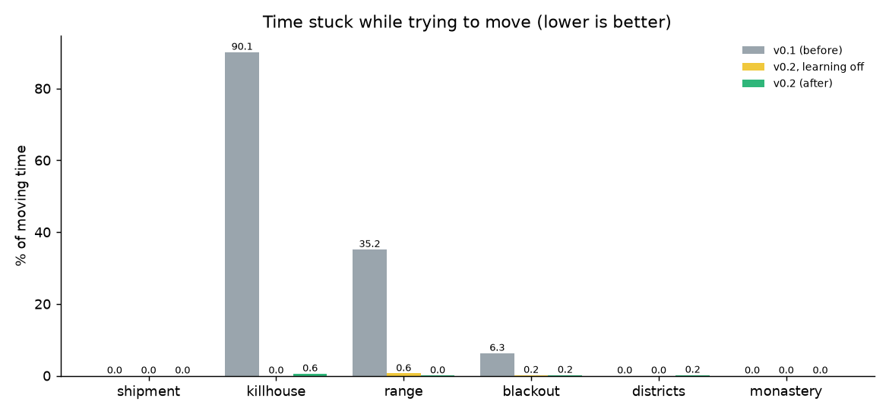
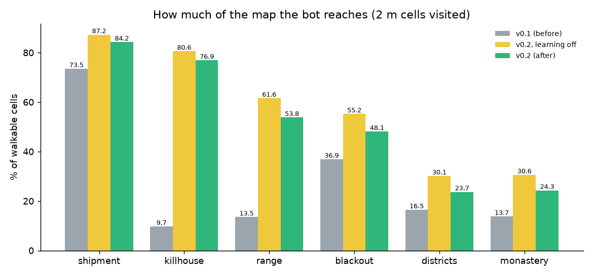
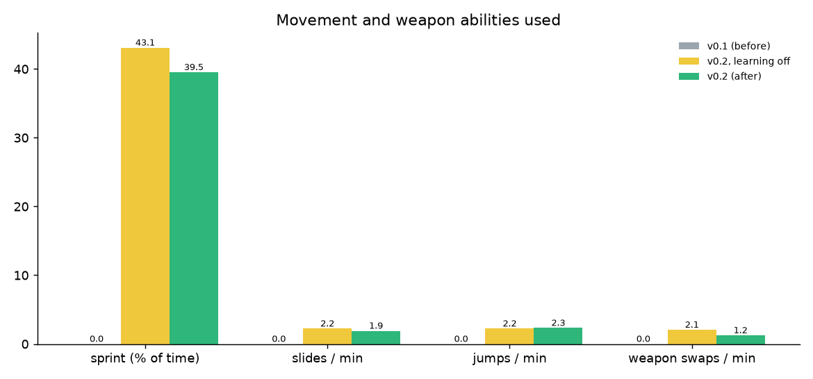
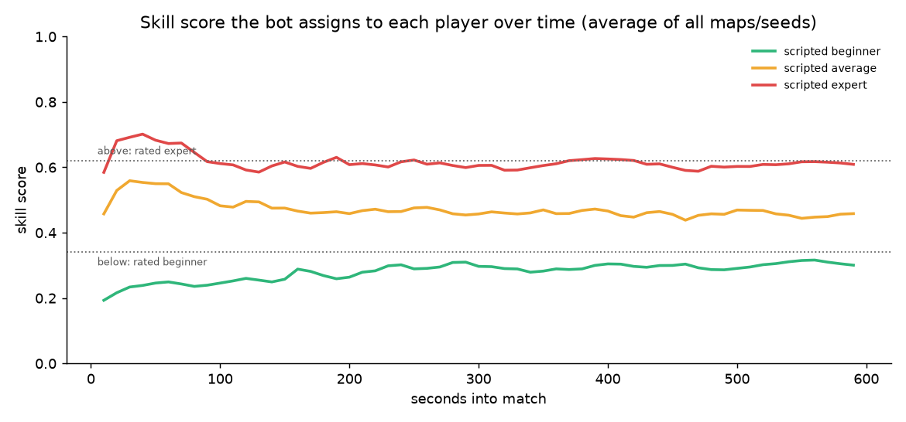
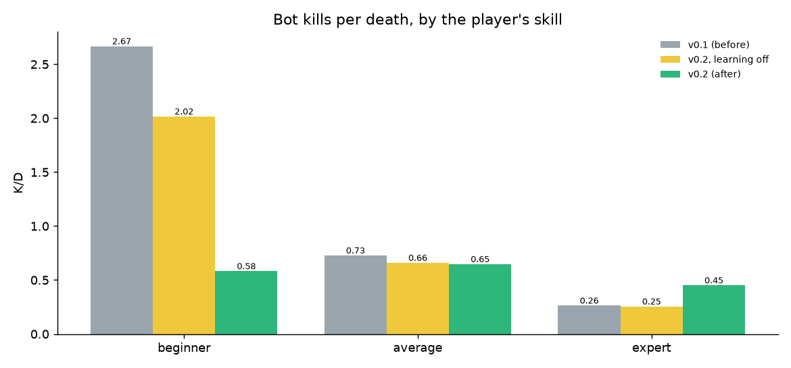
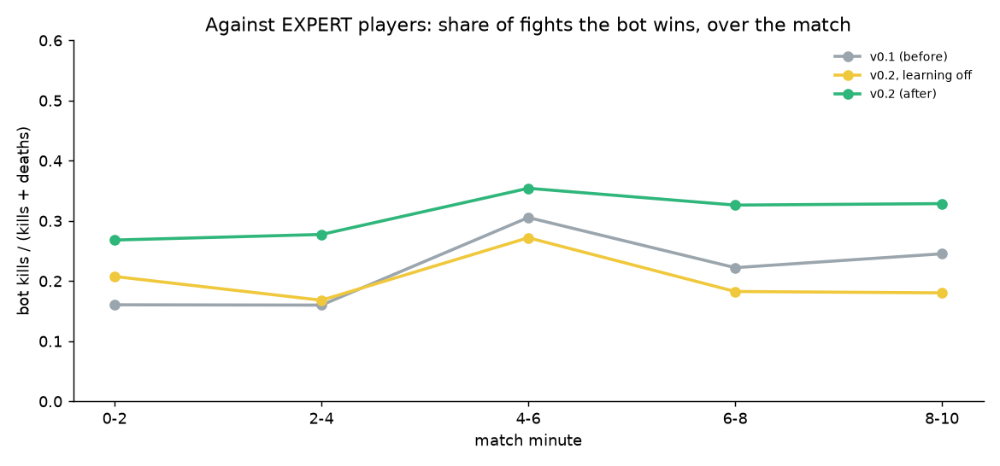

# Milestone 2: Nemesis bots v0.2 (measured against v0.1)

Siddharth Pathak · Full Sail CSMS capstone · 20 Nov 2026

This file is generated by `npm run m2` from `eval_out/m2/runs.json`. Every number below comes from
that run. Re-run it and the tables update.

## How it was measured

`tools/arena-eval.js` runs the real bot code (`ai/*.js`) in simulated LAB ARENA matches, faster
than real time: one Nemesis bot against one scripted human player.

- **Maps (6):** shipment, killhouse, range, blackout, districts, monastery.
- **Players (3 levels):** beginner, average, expert (`ai/nemesis-simplayer.js`). They move along a
  favourite route, strafe, sprint, slide, jump, swap weapons for the range, and shoot back with
  skill-based reaction time and accuracy.
- **Bot versions (3):**
  - **v0.1 (before):** the Milestone 1 bot, kept unchanged in `ai/legacy/`.
  - **v0.2, learning off:** new navigation, abilities and tactics, but nothing is learned about the
    player. This shows how much of the gain is from learning.
  - **v0.2 (after):** everything, learning the player while the match runs.
- **Size:** 3 random seeds × 10 simulated minutes per combination, 162 runs in total.
  Each seed uses the same dice for all three versions.

## Results at a glance

| Measurement | v0.1 (before) | v0.2, learning off | v0.2 (after) |
| --- | --- | --- | --- |
| Bot kills / deaths (all runs) | 329 / 431 | 559 / 872 | 503 / 945 |
| Time stuck while moving (avg) | 21.9% | 0.1% | 0.2% |
| Worst single run, time stuck | 100% | 5% | 2% |
| Runs where the bot got stuck more than half the time | 12 | 0 | 0 |
| Shots fired while facing more than 30 degrees away | 186 | 0 | 0 |
| Shots cancelled because the bot turned away | 0 | 0 | 0 |
| Map reached (2 m cells visited, avg) | 27.3% | 57.5% | 51.8% |
| Time sprinting | 0.0% | 43.1% | 39.5% |
| Slides / min | 0.00 | 2.23 | 1.91 |
| Jumps / min | 0.00 | 2.23 | 2.33 |
| Weapon swaps / min | 0.00 | 2.06 | 1.25 |
| Bot hit rate | 24.1% | 18.2% | 16.4% |

### Per map

v0.1 had no pathfinding, so on maps with corridors (killhouse, range) it spent most of the match
pressed against a wall. v0.2 plans routes with A* (a shortest-path search) over a walkable grid
built from each map's collision boxes, including stairs, jumps onto ledges, and drops.

| Map | v0.1 (before): stuck / reached / K-D | v0.2, learning off: stuck / reached / K-D | v0.2 (after): stuck / reached / K-D |
| --- | --- | --- | --- |
| shipment | 0.0% / 74% / 0.52 | 0.0% / 87% / 0.53 | 0.0% / 84% / 0.42 |
| killhouse | 90.1% / 10% / 0.39 | 0.0% / 81% / 0.63 | 0.6% / 77% / 0.57 |
| range | 35.2% / 14% / 0.07 | 0.6% / 62% / 0.40 | 0.0% / 54% / 0.43 |
| blackout | 6.3% / 37% / 0.91 | 0.2% / 55% / 0.59 | 0.2% / 48% / 0.53 |
| districts | 0.0% / 16% / 1.46 | 0.0% / 30% / 1.43 | 0.2% / 24% / 0.64 |
| monastery | 0.0% / 14% / 0.00 | 0.0% / 31% / 0.80 | 0.0% / 24% / 0.75 |

## Matching the player's skill (requirement 5)

The bot keeps a skill score for each player and updates it every 5 s. The score combines movement
(sprinting, slides, weapon swaps, strafing, jumps) with fight results (kills per death, how fast
fights end, damage per second). Once rated, the bot switches profile:

- **vs. beginner:** slower reaction, wider aim spread, no slides or weapon swaps, no flanking.
- **vs. average:** the normal kit.
- **vs. expert:** fastest reaction, tightest aim, slides and jumps often.

| Scripted as | rated beginner | rated average | rated expert | correct at 60 s | correct at end | median time until rated right for good |
| --- | --- | --- | --- | --- | --- | --- |
| beginner | 14 | 4 | 0 | 16/18 | 14/18 | 290 s (14/18 runs) |
| average | 2 | 16 | 0 | 12/18 | 16/18 | 135 s (16/18 runs) |
| expert | 0 | 7 | 11 | 17/18 | 11/18 | 315 s (12/18 runs) |

The level is right after 60 s in **45/54** runs and at the end of the match in **41/54**.
The weak spot is experts late in a match: as the bot learns them and wins more fights, their
fight score drops and some get re-rated "average". Next milestone: weight movement more once
confidence is high.

### What this does to K/D

| Player skill | v0.1 (before) K/D | v0.2, learning off K/D | v0.2 (after) K/D |
| --- | --- | --- | --- |
| beginner | 2.67 | 2.02 | 0.58 |
| average | 0.73 | 0.66 | 0.65 |
| expert | 0.26 | 0.25 | 0.45 |

The v0.1 bot crushed beginners and lost badly to experts. v0.2 is the other way round on purpose.
It eases off against beginners and does much better against experts. The overall K/D total in the
first table is lower for v0.2 because beginner matches are now close fights instead of blowouts.
Against experts, "learning off" (0.25) is no better than v0.1, so the improvement against experts
comes from learning.

## Getting better during the match (requirements 1 and 3)

What the bot learns, and how often:

| When | What it updates |
| --- | --- |
| every tick (20/s) | the player's position, speed, sprint, slide, jump and weapon-swap events, and strafe direction changes |
| every 1 s | habit averages (speed, sprint share, slides/jumps/swaps per minute, strafe flips per second) and the "where this player goes" heat map |
| every 1.5 s in a fight | a partial score for the current fight plan (damage dealt minus damage taken) |
| every kill and death | the full plan score (faster kills score higher, faster deaths score lower); the death spot and the spot the player shot from (the bot avoids the first and pre-aims the second); a lesson line on screen |
| every 5 s | the player's skill level |

Fight plans are close / mid / long range × push / hold / flank (9 plans). The bot picks one with
Thompson sampling: it mostly picks the plan that has worked best on this player, but still tries
others now and then.

Share of fights the bot wins against **experts**, by match minute:

| Match minutes | v0.1 (before) | v0.2, learning off | v0.2 (after) |
| --- | --- | --- | --- |
| 0-2 | 0.16 | 0.21 | 0.27 |
| 2-4 | 0.16 | 0.17 | 0.28 |
| 4-6 | 0.31 | 0.27 | 0.35 |
| 6-8 | 0.22 | 0.18 | 0.33 |
| 8-10 | 0.25 | 0.18 | 0.33 |

Kills per life against **experts**, by life number:

| Life # (vs. expert) | v0.1 (before) kills/life | v0.2, learning off kills/life | v0.2 (after) kills/life |
| --- | --- | --- | --- |
| 1-3 | 0.14 (n=36) | 0.30 (n=54) | 0.33 (n=54) |
| 4-6 | 0.28 (n=32) | 0.28 (n=54) | 0.50 (n=54) |
| 7-9 | 0.37 (n=30) | 0.41 (n=54) | 0.39 (n=54) |
| 10-14 | 0.33 (n=46) | 0.23 (n=83) | 0.41 (n=90) |

Against experts, v0.2 wins more fights than v0.1 from the first minutes, and its later lives are
better than its first three. The rise is not smooth. The simulated player gets the +25 HP kill
bonus and respawns at random points, so per-life numbers are noisy. Hypothesis H3 (win rate rises
life over life) is **partly supported**. It should be retested against real players next month.

## Bugs fixed

- **Shooting forward while looking backward (requirement 6).** In v0.1 a shot was planned, then
  fired 0.3 s later at the stored aim point even if the bot had turned to run for cover. v0.2 locks
  the bot's facing to the aim point during that delay, and cancels the shot if it is still more
  than 35° off when it fires. In the eval: 186 such shots in v0.1, 0 in v0.2.
  `tests/milestone2.test.js` checks both versions directly.
- **Getting stuck on objects (requirement 8).** v0.1 only steered at angles around walls. v0.2
  follows planned routes, jumps onto ledges, drops off edges, slides along walls when blocked, and
  replans after 1 s without progress (snapping back to the grid after 2 s). The grid excludes pits
  it could fall into but not leave.
- **All maps (requirement 7).** The bot works on all six LAB ARENA maps. Blackout's collision data
  was missing from `mapdata.json` (bots saw through its walls). `tools/dump-maps.js` regenerates it
  from the game client.
- **Fairness control removed (requirement 4).** The bot now plays to win, held back only by the
  expertise profile.

## Abilities (requirement 2)

v0.2 bots sprint on long moves and flanks, slide into fights, jump during strafes and onto ledges,
and swap weapons for the range: shotgun close, rifle mid, sniper long. Clients already animate
these from the `spr` / `sl` / `air` / `w` fields. See the abilities chart above.

## Watching it (requirement 10)

`npm start`, then open `http://localhost:8090/cod/?demo=1&map=killhouse&skill=expert`.

| Key | Does |
| --- | --- |
| V | camera: 3rd person (over the shoulder) → 1st person (the bot's eyes, with crosshair) → world (free camera: WASD, Q/E, Shift, drag to look) |
| M | next map |
| K | player skill: beginner → average → expert (watch the bot re-rate it) |
| L | show/hide what was learned (yellow tiles: where the player goes; red tiles: where the bot died; red arrows: spots the player shot it from) |
| H | panel size: full → small → hidden |
| N / Shift+N | aim model / forget the player |

The cyan line is the route the bot planned. The panel shows its state, plan, weapon, abilities,
the player's rated skill and habits, plan scores, and its latest lessons.

Screenshots of every map in every camera mode are in `docs/images/m2/`. The video is
`docs/media/nemesis_m2_demo.mp4`.

## Limits (honest list)

- The opponents are scripted players, not people. The next step is a session with real players.
- The v0.2 hit rate is lower than v0.1, because it shoots while strafing, sliding and sprinting,
  and uses wider aim against beginners.
- Shipment container tops can only be reached by climbing in the real game, so bots don't path
  onto them.
- Change to the design doc (for the next advisor meeting): H3 no longer refers to a fairness
  control. It now reads "win rate rises life over life", and a new H4 is "expertise is detected
  correctly within 60 s".
